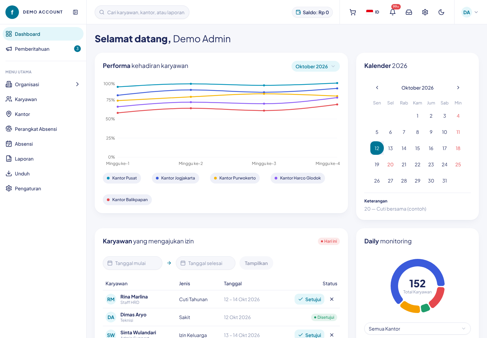
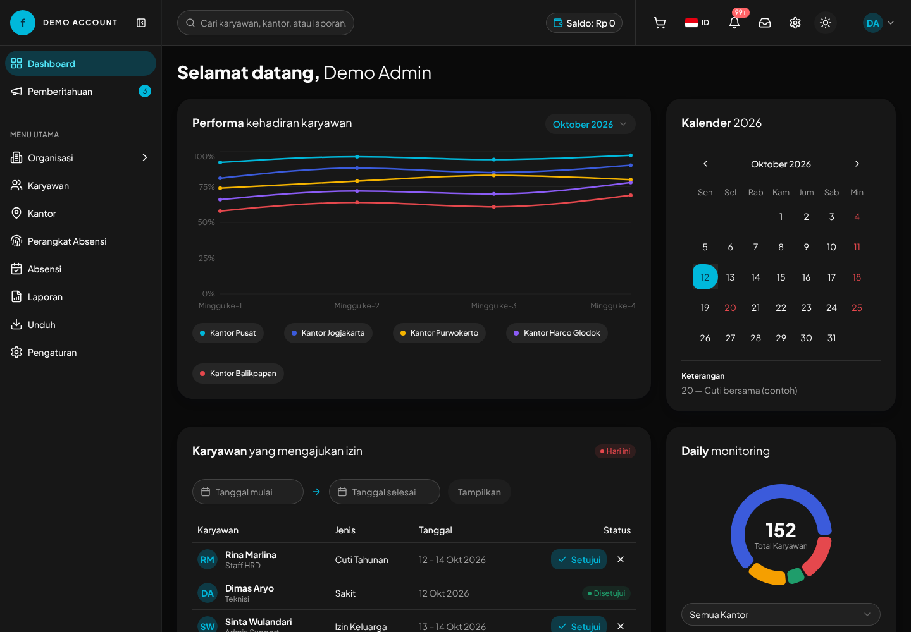
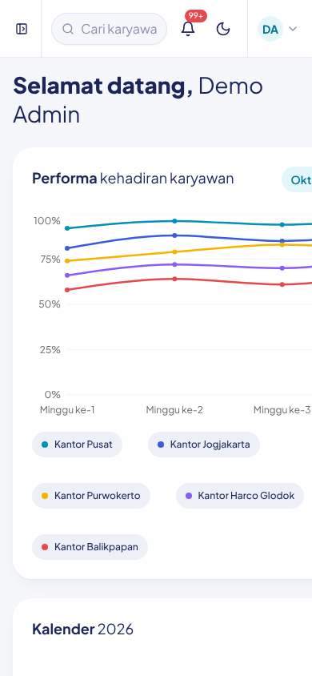

# Fingerspot.io — Redesign Dashboard

Redesign dashboard [fingerspot.io](https://fingerspot.io) dengan **React 19 + Tailwind CSS v4 + shadcn/ui**.
Fokusnya: tampilan yang bersih dan ramah, satu warna aksi (cyan), warna status yang konsisten, mode gelap, dan semua komponen berasal dari **registry resmi shadcn/ui**.

> Status: **prototipe UI**. Seluruh data masih berupa data contoh (`src/data/mock.ts`) dan belum terhubung ke API Fingerspot.

| Terang | Gelap |
|---|---|
|  |  |

<p align="center"></p>

## Fitur

**Pemberitahuan** (`/#/pemberitahuan`)

- Tab **Umum** dan **Layanan Saya** dengan jumlah belum dibaca, daftar berhalaman (10 per halaman).
- Status baru/terbaca, klik untuk membuka detail (`Dialog`), dan tombol **Tandai semua dibaca**.
- Empty state dan skeleton loading.

**Jabatan Fungsional** (`/#/organisasi/jabatan`)

- Tabel dengan *Tampilkan N data* (10/25/50/100), pencarian, urut nama (A–Z / Z–A / asli), dan paginasi.
- Tambah, Ubah (validasi nama unik), dan Hapus dengan konfirmasi; Empty state untuk data kosong/tidak ada hasil.

**Struktur Organisasi** (`/#/organisasi/struktur`)

- Pohon struktur dan jabatan yang bisa diperluas/diciutkan, dengan pencarian (kata yang cocok disorot) dan tombol Perluas/Ciutkan semua.
- Aksi per node: **Tambah** (Struktur/Jabatan/Kantor), **Ubah** (nama, kantor), **Hapus** dengan konfirmasi dan jumlah turunan; node akar tidak bisa dihapus. Ikon gedung + tooltip menunjukkan kantor yang terhubung.
- Di layar kecil aksi dilipat dalam satu menu “⋯”.
- Perubahan tersimpan di memori (belum ke API). Logika pohon ada di `src/lib/org-tree.ts`.
- Menu **Organisasi** di sidebar memiliki submenu (Collapsible; flyout saat sidebar ciut). Sidebar dibagi dua kelompok: Dashboard & Pemberitahuan, lalu “Menu Utama”. 

**Dashboard** (`/`)

- **Performa kehadiran** — grafik garis per kantor; legenda (`ToggleGroup`) menyalakan/mematikan seri.
- **Kalender** — shadcn `Calendar` berbahasa Indonesia, minggu mulai Senin, hari libur ditandai.
- **Karyawan yang mengajukan izin** — tabel dengan filter rentang tanggal, tombol Setujui/Tolak, dan Empty state.
- **Daily monitoring** — grafik donat + rincian status (tepat waktu, terlambat, izin, tidak hadir).
- **Detail kuota** — kartu pastel Perangkat, GPS, dan Karyawan.
- **Karyawan indisipliner** — filter rentang tanggal (maks. 30 hari), paginasi dengan ellipsis.
- **Data karyawan belum lengkap** — daftar dengan progress.
- **Sidebar** shadcn: ciut ke ikon di desktop, menjadi menu geser (Sheet) di mobile.
- **Mode gelap** — toggle di Topbar, tersimpan di `localStorage`, tanpa kedipan saat dimuat.
- **Skeleton loading** per kartu.

## Menjalankan

Prasyarat: **Node.js 20+**.

```bash
npm install
npm run dev        # http://localhost:5173
```

| Perintah | Fungsi |
|---|---|
| `npm run dev` | Server pengembangan |
| `npm run build` | Type-check (`tsc -b`) + build produksi ke `dist/` |
| `npm run preview` | Menjalankan hasil build secara lokal |

Halaman:

- `/` — Dashboard
- `/#/pemberitahuan` — Pemberitahuan
- `/#/organisasi/struktur` — Struktur Organisasi
- `/#/organisasi/jabatan` — Jabatan Fungsional
- `/#/design-system` — Showcase design system (warna, tipografi, komponen)
- Menu sidebar lain (Karyawan, Kantor, dst.) menampilkan halaman *“sedang dibangun”* sampai dikerjakan

## Tech stack

| Kebutuhan | Pustaka |
|---|---|
| Framework & build | React 19, Vite 6, TypeScript |
| Styling | Tailwind CSS v4 (token lewat variabel CSS) |
| Komponen | shadcn/ui (style `new-york`, base `radix`) |
| Grafik | Recharts via komponen `Chart` shadcn |
| Tanggal | react-day-picker, date-fns (locale `id`) |
| Ikon | lucide-react |
| Font | Plus Jakarta Sans |

## Struktur proyek

```
src/
├── components/
│   ├── ui/               # komponen shadcn (dari registry resmi + kustomisasi merek)
│   ├── organization/     # pohon organisasi + dialog tambah/ubah
│   └── dashboard/        # komposisi aplikasi: app-layout, shell (sidebar/topbar), nav, kartu, grafik, filter
├── data/                 # mock.ts (dashboard), announcements.ts (pemberitahuan) — data contoh
├── hooks/                # use-theme, use-hash-route, use-fake-loading, use-mobile
├── pages/                # dashboard, announcements, coming-soon, design-system
├── lib/                  # utils.ts (cn), org-tree.ts (data & fungsi pohon organisasi)
└── index.css             # design token (warna, radius, shadow, font)
docs/
├── DESIGN_SYSTEM.md      # dokumentasi design system lengkap
└── screenshots/
scripts/apply-brand.py    # memasang ulang kustomisasi merek setelah `shadcn add`
```

Komponen di `components/dashboard/` hanya **menyusun** komponen shadcn (tanpa elemen HTML mentah untuk input, tombol, daftar, paginasi, atau grafik). Satu-satunya file di `components/ui/` yang bukan dari registry adalah `date-picker.tsx` (rakitan Popover + Calendar).

## Design system

Ringkas:

- **Warna aksi:** cyan (skala Tailwind cyan yang dipakai tema shadcn: `cyan-700` terang, `cyan-500` gelap), hanya untuk komponen; latar halaman tetap netral. Teks navy `#1B2559`; kanvas `#F6F7FB`.
- **Status:** biru = tepat waktu, hijau = hadir/izin, oranye = terlambat, merah = tidak hadir/alpha.
- **Bentuk:** kartu `rounded-2xl` tanpa border dengan `shadow-card`; kontrol `rounded-xl`.
- **Mode gelap:** palet netral bawaan shadcn (hampir hitam) dengan aksen cyan.
- **Token** ada di `src/index.css` dan otomatis tersedia sebagai utility Tailwind (`bg-primary`, `text-danger`, `bg-tint-cyan`, …).

Dokumentasi lengkap: [`docs/DESIGN_SYSTEM.md`](docs/DESIGN_SYSTEM.md).

## Menambah komponen shadcn

```bash
npx shadcn@latest add <nama> -o -y   # -o menimpa file yang sudah ada
python3 scripts/apply-brand.py       # pasang ulang kustomisasi merek
npm uninstall cn                     # jika CLI memasang paket npm "cn"
```

Catatan: `shadcn add -o` menimpa file di `src/components/ui/`, termasuk kustomisasi merek (Button `soft`, Card tanpa border, Input `rounded-xl`, dll.). `scripts/apply-brand.py` memasangnya kembali dan juga memperbaiki impor `cn` yang kadang salah dihasilkan CLI (`from "cn"` → `@/lib/utils`). Skrip ini aman dijalankan berulang kali.

## Menghubungkan ke API

Data contoh dan simulasi loading ada di dua tempat:

- `src/data/mock.ts` dan `src/data/announcements.ts` — ganti fungsi/konstanta (mis. `disciplineRange`, `leaveRequests`, `dailyMonitoring`) dengan pemanggilan API.
- `src/hooks/use-fake-loading.ts` — ganti dengan `isLoading` dari query (mis. TanStack Query); skeleton di `components/dashboard/skeletons.tsx` sudah siap dipakai.

## Deploy

Proyek ini dapat langsung di-deploy ke [Vercel](https://vercel.com/new): preset **Vite**, build command `npm run build`, output `dist`. Routing memakai hash (`/#/design-system`), sehingga tidak perlu konfigurasi rewrite.

## Roadmap

- [ ] Sambungan ke API Fingerspot
- [x] Halaman Pemberitahuan
- [x] Struktur Organisasi
- [x] Jabatan Fungsional
- [ ] Halaman Karyawan (tabel, filter, dialog tambah/edit)
- [ ] Halaman Absensi dan Laporan
- [ ] Router sungguhan (React Router) menggantikan `use-hash-route`
- [ ] i18n (ID/EN)
